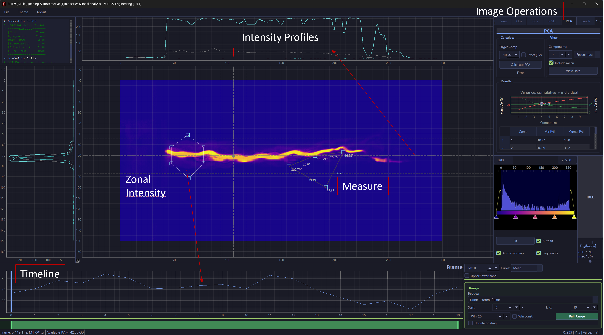

# BLITZ – Scientific Image Viewer

[](https://github.com/PiMaV/BLITZ/releases/latest)
[](LICENSE)
[]()
[]()

BLITZ (**Bulk Loading and Interactive Time series Zonal analysis**) is a matrix-based 2D viewer for large image datasets and single-image analysis — high-speed cameras, optical plasma diagnostics, and scientific `.npy` stacks.

Drag-and-drop images, video, or NumPy arrays. Check out the full **[WETTER](https://wetter.mess.engineering)** framework for **WOLKE**, **DONNER**, and the other loaders.



[](resources/public/blitz_demo.gif)
*(Click the animation for full size)*

---

# Download

[Download the latest release for Windows and Ubuntu](https://github.com/PiMaV/BLITZ/releases/latest)

No installation required — download and run the executable.

---

## WETTER Framework

BLITZ is the 2D interactive viewer in the **WETTER framework**. Loaders and siblings (**WOLKE**, **DONNER**, EVT, and more): **[wetter.mess.engineering](https://wetter.mess.engineering)**

---

## Key Features

- **High-Performance Data Handling:** Efficiently processes very large datasets (e.g. loading, scaling, and converting ~21,000 RGB images (~2.5 GB raw data) into ~6.2 GB of grayscale matrix data in ~30 s on a standard gaming laptop).
- **Easy Data Handling:** Drag-and-drop support for image, video, and NumPy matrix (*.npy) formats.
- **Easy to Use:** Automatic resource management for small and large datasets.
- **User-Friendly Interface:** Intuitive GUI with mouse-based navigation and shortcuts.
- **Advanced Image Processing:** Matrix-based processing with fast, Numba-accelerated statistics.
- **Live View:** Support for real USB cameras and simulated data streams.
- **Built on Python:** Using Qt and PyQtGraph for high performance and flexibility.

---

## Documentation

- [Quick Start](docs/walkthrough.md)
- [Tabs explained](docs/tabs_explained.md)
- [Full documentation index](docs/md_state.md)

---

## Development

To compile and develop locally:

1. Clone the repository:

   ```
    $ git clone https://github.com/PiMaV/BLITZ.git
    $ cd BLITZ
   ```

2. Set up a virtual environment and install dependencies with [uv](https://docs.astral.sh/uv/):

   ```
    $ pip install uv
    $ uv sync
    $ uv run python -m blitz
   ```

## Acknowledgements

Originally developed by Philipp Mattern at [INP Greifswald](https://www.inp-greifswald.de), now maintained at [M.E.S.S. – Mattern Engineering & Software Solutions](https://mess.engineering).

Early development was supported by Richard Krieg (student assistant) until v1.3.0 / January 2025.

## Additional Resources & Datasets

- **Example Dataset:** [KinPen Science Example Set](https://www.inptdat.de/dataset/fast-framing-images-kinpen-science-example-set-images-testing-blitz-image-viewer)  
  *High-speed camera recordings of a cold atmospheric pressure plasma jet (kINPen), ideal for testing BLITZ's fast matrix loading and time-series analysis capabilities.*
- **Plasma Data Repository:** [INPTDAT](https://www.inptdat.de)  
  *Explore disciplinary datasets for low-temperature plasma physics or contribute your own.*

## License

BLITZ is licensed under the [GNU General Public License v3.0](LICENSE).
