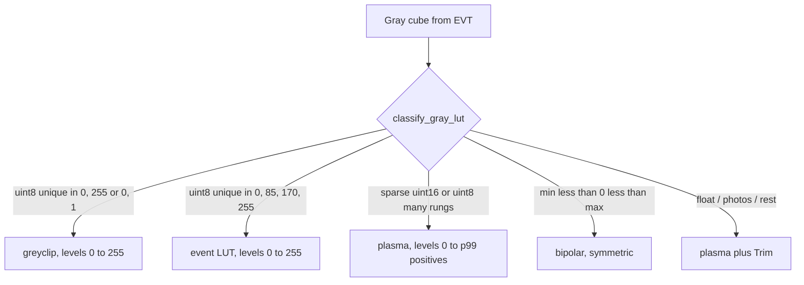

# Exotic formats and the standard loader

BLITZ’s **standard loader** (GitHub EXE / `uv run`) focuses on:

- Images, video, `.npy`
- ASCII grids (`.asc` / `.dat` / probed `.txt`)
- In-core HIKMICRO radiometric JPEG → approximate °C (numpy only)
- Folder chooser when a directory contains mixed groups

## What stays out of the core

Domain / exotic formats (historical DICOM path, OMERO, Bio-Formats, …) are **not**
embedded in the shipped viewer. That keeps the artifact lean and avoids optional
heavy dependencies.

## Sidecar bridges (policy)

When BLITZ should “handle more formats” without bloating the core, use a
**suite sidecar** (Go binary with Viewer Contract hub, or EVT Python):

1. Convert / mosaic / bin outside the viewer.
2. **Send** over Socket.IO + HTTP `.npy`, or save `.npy` and open in BLITZ.

### EVT3 event cameras (IDS / Prophesee)

**Event reader** (`../EVT/`) is the exotic path for EVT3 `.raw`
archives: decode once, re-bin with live Δt / polarity / window, and push stacks
to BLITZ (and DONNER) over the **WETTER Viewer Contract** (Socket.IO + HTTP
`.npy`; same hub as WOLKE). Not embedded in BLITZ. A later
live/multi-cam streamer (**FUNKE**) is backlog only. Viewers do not peer-sync;
playhead index goes hub-and-spoke (`viewer_index` / `send_file_message` +
`index`). See [`../../WETTER/docs/interoperability.md`](../../WETTER/docs/interoperability.md).

**Event cube:** the sidecar **Send as** is one of:

- **states** (default) — one `uint8` channel, four even rungs: 0 = nothing,
  85 = OFF, 170 = ON, 255 = both. Auto uses **`event`** (black → red → green
  → yellow) pinned 0…255. Any other colormap works on the same rungs.
- **counts** — `uint16` gray events/pixel/Δt (activity `ON+OFF` when polarity
  is color). Auto uses **plasma**, levels 0…p99 of positives.
- **occupancy** — `uint8` gray binary 0/255. Auto uses **greyclip**, levels
  0…255 (or 0…1).

Signed / ON-only / OFF-only are gray views of the same planes (counts or
occupancy). Stream ingest does **not** apply File-tab 8-bit / grayscale
(8-bit would zero uint16 counts).

### DGM / GeoTIFF tiles (LGL)

Do **not** mosaic in the BLITZ folder loader (that would stack tiles as `T`).
Product: suite `../DGM/` (GitHub `PiMaV/dgm-mosaic`) — download the binary or
`uv run dgm-mosaic`. Stream: `http://127.0.0.1:5056`, token `dgm` (`(1, H, W)` plane).

### HIKMICRO / DICOM

Parked as separate sidecars. Single HIKMICRO JPEG stays in-core in BLITZ.
DICOM is out of scope until un-parked.

Do **not** grow the core viewer with exotic native deps unless a format is
numpy/cv2-only and clearly belongs in the standard loader (like HIKMICRO).
